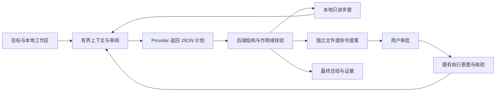

# DeskPilot 0.2 Agent 编排

在 **Tasks** 选择工作区、Provider 和模型，输入目标和最多四个相关文件路径。未指定文件时，Agent 可以先读取项目元数据和候选路径，再申请把需要的文件加入下一轮预览。

每轮上下文显示将发送的内容、目标端点和预算。审阅哈希绑定原始内容、计划策略、模型、费率、任务和工作区身份。确认时重新构建上下文。文件、作用域或任务状态变化时，重新审阅。新测试输出进入下一轮预览。

每个计划最多 6 步，最多提出 1 个需要审批的动作。模型可以提出读取、搜索、环境诊断、分析、核对结果、修改或测试。未知类型、重复字段、超限数据和不受支持的命令拒绝。现有文件通过原始 SHA-256、身份和完整的替换文本形成准确 Diff。命令通过固定模板，要求确认项目代码可能访问网络，再单独批准。模型输出不会执行工具或授权操作。

默认每个任务最多 5 次模型请求、15 分钟、每次最多 1,536 输出 token，按模型配置的美元费率预留最多 0.10 美元。预算估算用输入字节保守估计 token 数。请求发送前保存预算预留，包括随后失败或取消的请求。Provider 实际计价由服务商决定。状态、用量和费用估算可在计划历史查看。

暂停、取消和 Stop All 传播到请求和受控子进程。恢复保留此前已消耗的预算和动作记录，重新审阅上下文。结果未知时，先检查当前目标，再确认恢复。重启撤销未使用审批，已消耗的动作不自动重放。

计划版本存于现有任务 JSON，步骤沿用任务步骤表。产品提案保存版本、步骤 ID、策略版本和完整参数哈希。SQLite v6 新增电脑证据关联，现有电脑审批和截图审阅保持独立授权。任务预览只使用关联事件的状态和类型，不重新附带截图或自动发送识别文本。
