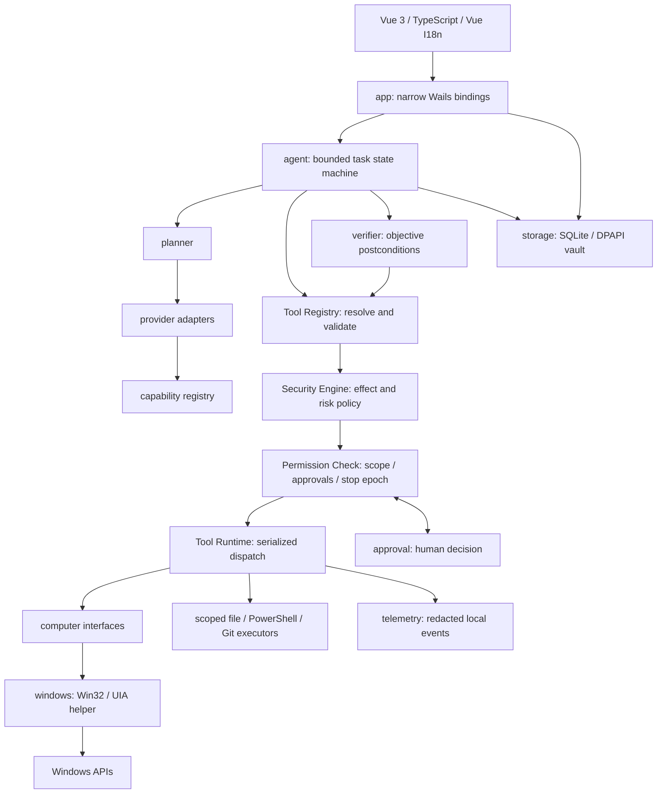
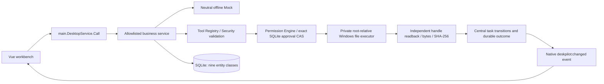

# DeskPilot AI — Architecture

For the Community 0.2.1 implementation, see [configuration](0.2.1/CONFIGURATION-ARCHITECTURE.md), [developer context](0.2.1/DEVELOPER-IMPROVEMENTS.md) and [security](0.2.1/SECURITY-REVIEW.md).

Status: Phase 1 implementation plus the broader Phase 0 design. The final section
maps the implemented `internal/` packages and bounded execution loop; preceding
sections retain future product boundaries. Go remains the business core.

## Components and mandatory dispatch



Any verifier observation is a tool request through the same permission path.
The UI, provider, planner and agent cannot import `internal/windows`. Native
executors are constructible only inside app wiring; production tests must inspect
the import graph and exported Wails bindings to prevent bypass.

| Module | Responsibility | Depends on / boundary |
|---|---|---|
| app | Composition, settings DTOs, Wails lifecycle | Inject services; no raw shell/window handle binding |
| agent | Task state, budgets, step loop, pause/cancel | Planner, registry facade, verifier, task repository |
| planner | Intent → bounded proposed steps | Provider-neutral request/result and capability lookup |
| verifier | Pass/fail/inconclusive against postconditions | Approved observations, deterministic checks first |
| provider | Native protocol mapping, transport, streaming | Neutral DTOs, key reference, endpoint policy |
| capability | Model facts and explicit probe evidence | Provider/model/baseURL/revision/time, tri-state support |
| tools | Schemas, registration, dispatch facade/runtime | Mandatory security → permission check |
| computer | Platform-neutral observation/action contracts | No Win32/COM types in public protocol |
| windows | Native capture/input/DPI/UIA implementation | OS handles are opaque, session-scoped IDs to callers |
| security | Risk/effect policy, directory/endpoint scope | Immutable policy version, trusted decision inputs |
| approval | Preview and exact human authorization | Task/action hash, expiry, nonce and revocation |
| storage | Repositories, migrations, config and vault | SQLite; DPAPI only for secrets; transaction boundaries |
| workflow | Later reusable task definitions | Same planner/tool/security contracts, no bypass |
| telemetry | Local event timing, outcomes and redaction | No remote export by default |

## Proposed contracts

These signatures define Phase 1 design; only disposable subsets exist in probes.

```go
type Provider interface {
    Generate(ctx context.Context, req ModelRequest) (ModelResult, error)
}
type Registry interface {
    Execute(ctx context.Context, req ToolRequest) (ToolResult, error)
}
type SecurityEngine interface {
    Assess(ctx context.Context, req ValidatedRequest, facts TrustedFacts) (Decision, error)
}
type PermissionChecker interface {
    Authorize(ctx context.Context, req ValidatedRequest, decision Decision) (Permit, error)
}
type Verifier interface {
    Verify(ctx context.Context, goal Postcondition, result ToolResult) (Verdict, error)
}
type Computer interface {
    Observe(ctx context.Context, req ObserveRequest) (Observation, error)
    Act(ctx context.Context, permit Permit, action ComputerAction) (ActionResult, error)
}
```

`ModelRequest` carries immutable task instructions, explicitly untrusted observed
content, messages, typed text/image blocks, offered tool schemas and a budget.
`ModelResult` carries text, typed tool proposals, usage, finish reason and optional
provider continuation data inside the adapter boundary. Native SDK structs never
reach the agent. `ToolRequest` contains task/step/tool ID, schema version, bounded
arguments, context snapshot ID and idempotency key. `ToolResult` contains outcome,
typed payload, evidence references and error code/parameters, not translated copy.
`Permit` is internal/opaque: task/action hash, policy version, scope, expiry and
stop epoch; the model cannot supply one. `Verdict` is pass/fail/inconclusive with
evidence IDs and a bounded retry recommendation.

## Task and data flow

State: created → planning → awaiting_plan_approval → ready → checking_permissions
→ awaiting_action_approval when needed → executing → observing → verifying →
succeeded / failed / paused / cancelled. Only verifier pass completes a task.
Inconclusive observations can replan within budget or pause. Invalid schemas,
permission denial, helper timeout and budget exhaustion cannot fall through to
execution. Cancellation increments a stop epoch and invalidates queued permits.

Store tasks, immutable plan versions, steps, redacted tool results, approval
decisions, events and settings in SQLite. Proposed tables: `tasks`, `plans`,
`steps`, `approvals`, `events`, `settings`, `providers`, `model_capabilities`,
`secrets`. Secret rows contain DPAPI blobs and key references, never plaintext.
Use ordered migrations with `user_version`, transactions, one writer, WAL and
busy timeout. Handle disk-full/corruption before claiming a persisted operation.
Schema/recovery beyond the settings spike is not implemented.

## Provider and capability design

Priority adapters: OpenAI-compatible Chat Completions and OpenAI Responses.
Responses maps text/image blocks to `input_text`/`input_image`; Chat Completions
uses text/`image_url` content. Their tool calls, errors and stream event shapes
need separate adapters. The offline Phase 0 encoders are shape probes only,
not live conformance tests. The official [image input guide](https://developers.openai.com/api/docs/guides/images-vision)
documents these distinct input forms. Future Anthropic/Gemini adapters implement
the same neutral interface, not protocol aliases.

Registry record: provider ID, model ID, base URL, protocol/revision, text, vision,
tool calling, streaming, structured output, computer-use support, context limit,
optional timestamped pricing/currency, evidence source and verification time.
Each capability is supported/unsupported/unknown. Unknown fails closed for tools
and vision. Model-list endpoints alone prove neither. Capability tests require a
separate user-approved paid call; Phase 0 uses mocks only. Configured endpoints
are trust boundaries: HTTPS, credential origin binding, redirect restrictions,
timeouts, response limits and explicit approval for local-network endpoints.
No automatic cross-provider credential forwarding or model fallback.

## Computer action protocol and coordinates

Version 1 actions: click, double_click, right_click, move, scroll, drag, type_text,
press_key, screenshot and wait. All include target session/window ID and deadline.
Coordinates are tagged `screen_physical`, `window_client_dip`, or `image_pixel`;
there is no untagged pair. Drag has start/end; scroll has unit and signed deltas;
key presses use an allowlisted chord; waits have capped duration; text has size
limits and a sensitive-field rule. Screenshot carries crop/monitor IDs and upload
approval separately. Unknown fields/actions, nonfinite numbers and out-of-range
points are rejected. The spike validates only screenshot/click; remaining action
types are design scope for Phase 2, not implemented support.

Canonical executor coordinates are signed physical virtual-desktop pixels.
Origins may be negative. An Observation includes capture ID/time, monitor layout
revision, physical crop rectangle, image width/height and scale transform.
Map image `(x,y)` as `left + floor(x*physicalWidth/imageWidth)` and similarly for y,
with `0 <= x < imageWidth`. A provider's normalized 0–1 or 0–1000 coordinates
must be converted by its adapter using that observation, never guessed.
Window DIPs convert via the *current target window DPI*, then client-to-screen;
invalidate observations after move/resize/display topology/DPI change.
SendInput absolute mapping uses `(physical-origin)*65535/(extent-1)` and the
VIRTUALDESK flag. A PMv2 manifest/thread policy is mandatory; fixture DPI 96 does
not describe monitor scaling when the fixture is DPI-unaware.

## Windows implementation choice

Prefer Go Win32 calls for deterministic capture/input/window/process operations.
No RobotGo dependency is necessary for the measured path. The GDI capture spike
does not establish performance or support for protected/HDR/GPU surfaces; assess
Windows Graphics Capture later if needed, without changing the abstraction.

Direct Go COM was checked for MTA initialization and IUIAutomation construction/
release only. Full direct vtable traversal/event lifetime remains unverified.
The C# UIA helper proved Invoke/Value/Selection/Text on a controlled fixture.
Recommendation: prototype an isolated helper with authenticated, bounded local
IPC in Phase 2 before choosing the shipping implementation. Go owns policy,
task state and orchestration. Helper operations still require a Go-issued permit.
Use one dedicated non-UI MTA worker; Go direct access requires LockOSThread,
balanced CoInitializeEx/CoUninitialize, Release for every owned interface and
event deregistration on the owner thread. Follow Microsoft's [threading rules](https://learn.microsoft.com/en-us/windows/win32/winauto/uiauto-threading).
The spike uses .NET Framework system assemblies, not an approved shipping runtime.

UIA provider calls may hang beyond a context deadline. Enforce a process watchdog,
bounded tree traversal/cache, stale-element retries and helper restart; no repeated
click on an unknown result. Prefer Invoke/Value/Selection, then visual fallback
with fresh observation and approval. Do not automate UAC or the secure desktop.

## Phase 1 implemented architecture

The root Go module and `main.go` now compose `internal/app` (business services,
task state machine, persistence), `internal/provider` (neutral contracts and offline
Mock), `internal/domain` (DTOs/vault interface) and `internal/tools` (security,
permission boundary, private NT executor and separate verifier). Larger planned
module names above are boundaries for future extraction; empty packages were not
created merely to reproduce a directory diagram.



The service exposes the methods listed in PHASE-1-PLAN through a strict dispatcher,
not a raw command/state/file/SQL API. Frontend uses native Wails Call.ByName and
Events.On. Event notifications refresh affected business data; there is no frontend
polling loop. The SQLite approval callback is private to app wiring, is always
invoked by Registry.Execute, and cannot be supplied by the model or WebView.
The registry releases its mutex around that callback and rechecks its reservation,
workspace pins, cancellation and expiry before IO, avoiding lock inversion.

Task states are CREATED, PLANNING, WAITING_APPROVAL, RUNNING, VERIFYING, COMPLETED,
FAILED, PAUSED and CANCELLED. Only the central transition function changes status.
The fixed one-tool loop replaces an unbounded autonomous loop in this phase.
Registry.Execute owns execution and readback; after it returns the app records a
durable VERIFYING checkpoint and checks all objective fields before completion.
Mock.Summarize receives the actual verification/error outside the control mutex;
its text cannot override the completion oracle.

SQLite schema v1 has `app_settings`, `provider_profiles`, `conversations`,
`messages`, `task_sessions`, `task_steps`, `approval_records`, `tool_executions`
and `audit_events`, with foreign keys/indexes/timestamps. Complex snapshots are
typed JSON alongside relational IDs/status/index columns. Startup initializes
defaults without reading OS language and pauses interrupted tasks while invalidating
unused approvals. Recovery never resumes operations automatically.

Default data location is `%LOCALAPPDATA%/DeskPilotAI`; the launcher alone may
choose a test data directory. No model/UI method changes the workspace root.
The window uses embedded assets, restrictive CSP, denied web media/clipboard
permissions and text-only Markdown rendering. A CLI-gated acceptance service/CDP
port exists only in explicit test launches; ordinary launch binds only business
Call and does not load the acceptance script. Details and API table are in the
Phase 1 report.

## Phase 2A recovery and shutdown

Schema v2 adds `file_intents` alongside the original v1 tables. Approval
consumption, the intent row and its audit event share a transaction. The registry
flushes the staged file and records a Windows file witness before the atomic
no-replace rename. The witness records volume serial, native file ID and creation
time. Final task, steps, execution evidence, message, audit and intent settlement
share a separate transaction. File I/O stays outside SQLite transactions.

An exclusive profile handle protects startup recovery. The recovery engine reads
unsettled records before admitting calls. It independently matches the approved
path, native identity and bytes. A match reconciles the original execution.
Missing, replaced or modified targets and legacy consumed operations without a
witness retain `RECOVERY_REQUIRED`. Recovery invokes only the private readback
path. It preserves original approval and execution IDs.

Window closing gates calls and cancels the service lifetime. The drain waits
for workers while SQLite is available, closes storage and registry handles,
then closes the native window before allowing Wails to quit. The frontend
unsubscribes its own Wails listener during teardown. See
[Phase 2A report](PHASE-2A-REPORT.md).

## Phase 2B text and vision path

`internal/ai` adds neutral text/image contracts and independent Responses/Chat
Completions HTTP/SSE adapters. `internal/credential` uses current-user DPAPI.
Additive application AI services orchestrate confirmed requests, local context,
selected attachments and usage. SQLite v3 adds separate AI configuration,
credential, message-metadata, request, attachment and usage records while reusing
the original conversations/messages. Historical v1/v2 migrations stay unchanged.

Real AI requests are separate from `provider.Mock` task planning. There is no
real-model-to-Tool-Registry path. Model output is text/vision evidence only; tool
calls are rejected. Assistant and Playground share the same Go adapter path.
Workers inherit service lifetime and are drained before storage closes. Pending
network requests found after restart are unknown outcomes, never auto-replayed.
Window-first Wails shutdown and file RECOVERY_REQUIRED reconciliation remain.

See [Provider architecture](PROVIDER-ARCHITECTURE.md),
[Credential security](CREDENTIAL-SECURITY.md) and [Usage](USAGE-AND-PRICING.md).

## Phase 2C screen analysis

A separate read-only screen driver enumerates displays and captures the selected
physical rectangle through Win32 GDI on a Per-Monitor Aware V2 thread. Screen
previews and one-shot upload consent live in memory. The confirmed image uses
the existing Assistant worker and Provider Adapter. SQLite v3 message metadata
holds capture details and validated vision results. [Computer vision architecture](COMPUTER-VISION-ARCHITECTURE.md)

## Phase 2D · Computer Control

Computer Control 通过独立 `internal/computer` 驱动与 `internal/app/control_service.go` broker 提供固定测试窗口操作。C# MTA worker 以单请求进程隔离 UIA，WinForms STA host 提供无外部效果的测试控件。SQLite v4 独立记录单次审批、执行意图及事件。逐动作核验之后再执行，效果需经独立读取验证。原有文件、BYOK、Vision 路径继续各自管理权限。

完整设计见 [Computer Control Architecture](COMPUTER-CONTROL-ARCHITECTURE.md) 和 [Windows UIA Implementation](WINDOWS-UIA-IMPLEMENTATION.md)。
## MVP 0.1

MVP 0.1 的工作区、任务、审批、退出和 v5 持久化结构见 [产品架构](PRODUCT-ARCHITECTURE.md)。
