# Computer vision architecture

Phase 2C adds read-only Windows display capture to the Computer page and
Assistant. The capture driver exposes display enumeration, selected-display
capture, and display-relative region capture. An analysis response is a regular
Assistant message with optional validated vision fields.

```mermaid
flowchart LR
  A["User selects a display and clicks Capture"] --> B["Win32 GDI on a PMv2 thread"]
  B --> C["Go memory cache and WebView preview"]
  C --> D["Optional crop, redaction and encoding"]
  D --> E["Review the exact preview and model destination"]
  E --> F["User confirms Send"]
  F --> G["Existing Provider Adapter and SSE"]
  G --> H["Assistant text, vision result and Usage"]
```

The driver follows the Phase 0 GDI approach. Each native call re-enumerates
display bounds in a pinned OS thread with Per-Monitor Aware V2 context.
Display identity is the current Win32 monitor device name. Physical coordinates
remain signed. Logical coordinates describe each monitor at 96 DPI and serve
as display metadata. Region math uses physical coordinates. On return the
driver restores the thread DPI context and releases the screen DC, memory DC,
and bitmap. The bitmap is deselected before GetDIBits.

The application encodes an opaque PNG by default. Users can crop within the
current preview, add a solid black privacy mask, or switch the preview to JPEG.
Every transform replaces the preview ID and invalidates its upload consent.
The capture budget is 24 million pixels, 8192 pixels per side and 12 MiB of
encoded bytes. Captures and transforms run one at a time. The in-process cache
holds up to two previews with a two-minute lifetime from capture.

Screen analysis uses the existing Phase 2B chat worker, HTTP adapter, DPAPI
credential flow, cancellation context, SSE events, request recovery, and Usage.
The confirmed outbound message contains the selected screenshot and current
question. Prior context for this request contains conversation text. The app
stores the question, raw reply, optional parsed result and screenshot metadata
in v3 message records. Subsequent text questions can reference the reply.

The prompt treats visible text as untrusted evidence and asks for visible
details, OCR text, applications, windows, UI elements, issues, suggestions and
uncertainties. Optional element positions are validated as 0–1000 bounds
relative to the screenshot. The UI displays these as descriptions. If the JSON
does not pass validation, the raw text remains available with a parse notice.

DeepSeek Flash uses the documented Chat Completions image part. The preset
applies to `deepseek-flash` only. The adapter disables thinking for this model
on the official HTTPS endpoint so its output budget is available for visible
analysis. [DeepSeek Vision](https://api-docs.deepseek.com/guides/vision/) ·
[Chat Completions](https://api-docs.deepseek.com/api/create-chat-completion/)

The Windows implementation supports visible display pixels. Window-handle
capture and recovery of minimized or obscured windows remain unavailable.
Protected surfaces, HDR, exclusive full screen and different GPU drivers
require additional hardware verification.
