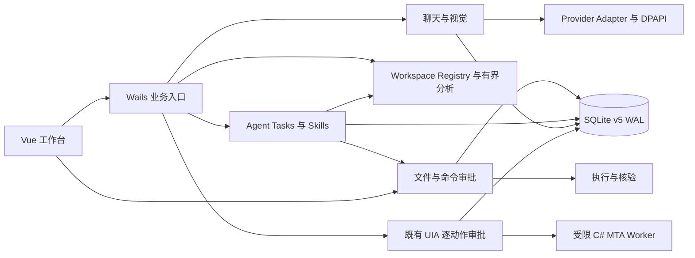

# DeskPilot AI MVP 0.1 产品架构

DeskPilot 是 Windows 本地工作台。Vue 3 负责会话、电脑观察、工作区和审批界面。Wails v3.1.0 的 `DesktopService.Call` 是业务入口。Go 管理 SQLite、Provider、Windows 辅助程序和动作生命周期。

| 模块 | 集成方式 |
| --- | --- |
| Assistant | 复用多轮聊天、Markdown、附件、Provider 和模型能力、用量、取消与错误处理。首次启动可跳过 Provider。 |
| Computer | 复用捕获、显示器选择、裁剪、遮盖、上传审阅、UIA Inspector、时间线与停止。固定测试窗口和候选 Notepad 走既有 v4 审批链。 |
| Developer | 原生选择器注册本地工作区。目录、搜索、依赖和符号分析有界运行。读取后的内容可送入聊天草稿供用户审阅。 |
| Environment / Command | 固定版本探测和项目命令。命令提案显示可执行程序、参数数组、目录、网络风险和资源限制。 |
| Tasks | 本地目标生成项目分析、相关内容搜索、环境诊断步骤。用户可预览并发送有界上下文给 Provider，再把文件或命令提案关联到任务。 |
| Skills | 八个内置条目记录能力、输入输出和允许工具。技能启用状态不会授予动作权限。 |

v5 新增工作区、Agent Task 和步骤、产品动作与事件及执行意图、技能设置和首次启动状态。任务复用既有会话作为可选 Provider 分析记录。Phase 1 的独立工具和 Phase 2D 的控制记录继续沿各自经验证的存储和执行链运行。共同工具目录列出三条链的权限，统一的停止入口取消它们的工作。产品动作在短事务内消耗审批并写入执行意图，随后执行文件或进程 I/O，最后落库核验结果。重启仅处理记录状态。

正常关闭维持窗口优先退出顺序。关闭准入并排空工作后发起原生窗口关闭，确认窗口已移除再退出 Wails。SQLite v1～v4 原迁移和旧数据保留。
