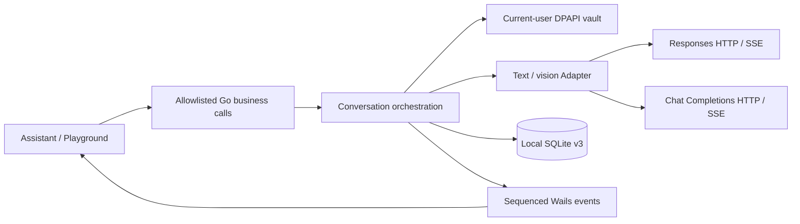

# Provider architecture — Phase 2B

Phase 2B adds text and user-selected image conversations. The Phase 1 Mock planner
continues to own the existing approved file task flow. The real AI path has no
Tool Registry reference, permit, Windows action or task-state mutation authority.

`internal/ai/types.go` holds provider-neutral profile, capability, content, request,
response, usage and price snapshot types. The Adapter owns Generate, Stream,
TestConnection and GetCapabilities. Profiles may use either protocol, arbitrary
explicit Model IDs and a user-configured Base URL. A gateway is compatible only
to the extent it implements the selected protocol; no gateway-specific transport
or automatic compatibility claim exists. Anthropic/Gemini native protocols remain
unimplemented. No model, price or capability is inferred from a marketing name.

Responses uses local message context, `store=false`, input_text/input_image and
the native response event lifecycle. Chat Completions uses messages, text/image_url,
delta choices and `[DONE]`. Both protocols prohibit requested local tools and
reject tool/function/computer call output as `UNSUPPORTED_TOOL_CALL`.

The HTTP client uses context cancellation, finite connection/header/request
timeouts, certificate validation and bounded response/event bodies. It does not
retry requests or follow redirects. Unknown dispatched outcomes require a user
decision to resend. Provider error bodies and transport errors are converted to
stable codes rather than forwarded to the WebView. Credentials travel only in
the backend Authorization header.

The frontend calls only the native Go dispatcher. It does not fetch model
endpoints. Explicit send/test actions may incur provider charges. Selecting or
saving a provider performs no network probe. Manual capability entries are user
assertions; a successful text request does not prove vision support.

Protocol references checked on 2026-11-11:

- [Text generation](https://developers.openai.com/api/docs/guides/text)
- [HTTP streaming lifecycle](https://developers.openai.com/api/docs/guides/streaming-responses)
- [Image input](https://developers.openai.com/api/docs/guides/images-vision)
- [Local conversation context](https://developers.openai.com/api/docs/guides/conversation-state)

See PHASE-2B-ACCEPTANCE for the difference between loopback protocol verification
and a real provider/model test initiated by the user.
