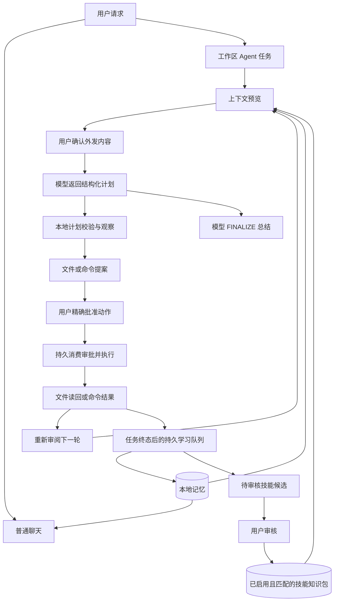

# Asimi 实现状态评估报告

日期：2026-11-14\
对象：本地工作树，Asimi 0.2.1\
基础提交：`4ee9051a3f126801c8f2ffd2a9026621d44edb36`，**包含当前尚未提交及未跟踪的源码**。

本报告检查代码、调用关系、持久化结构、测试和现有验收记录。没有修改产品代码、提交源码、发布安装包或读取用户日常数据库。本次重新运行了测试与前端构建，没有新发起真实模型服务或原生桌面交互验收。

## 1. 总体判断

**当前是有真实后端和受控执行闭环的 Windows 桌面 AI 试用产品，尚不是完成度充分的通用自主桌面 Agent。**

三个引擎均有实际实现，但成熟度不同：

| 引擎 | 当前定位 | 已成立的能力 | 不能据此宣称 |
| --- | --- | --- | --- |
| 记忆 | 有限的本地持久记忆与上下文检索系统 | 保存、跨重启、作用域隔离、归档、词法检索、聊天/Agent 注入、任务后学习 | 全面对话自动记忆、语义记忆、模型训练、完善的冲突治理 |
| Skills | 可版本化、可审核的技能知识包系统 | 创建/启停、版本恢复、JSON 导入导出、候选审核、检索和提示复用 | 动态插件运行、任意 SKILL.md 即装即用、技能级强制权限隔离 |
| Harness | 每轮需用户审阅的有限开发 Agent 运行时 | 规划、动作审批、持久执行、文件读回、命令结果、停止及恢复 | 通用工具自动编排、独立目标验证、无人值守多应用操作 |

最扎实的部分是**动作的精确审批、落盘与验证、安全边界和恢复策略**。最需要补齐的是**任务级完成判定、技能的运行时约束、知识规模化管理，以及正常聊天与执行入口之间的产品闭环**。

不提供一个“总体完成百分比”：当前没有经过权重和验收标准定义的功能清单，给出 80% 或 90% 会掩盖关键缺口。本报告用“已落地／有限完成／未实现／待验收”逐项说明。

## 2. 三个引擎如何连接

这里有三点必须区分：

1. 普通聊天已经使用个人记忆，但不直接执行工具，也不注入 Skills。
2. Agent 任务会使用记忆和技能参考，但具体动作仍走固定的本地执行代码及逐次审批。
3. “学习”是保存证据、规则提取、模板生成与下次提示复用，没有改变基础模型的权重。

## 3. 记忆引擎

### 3.1 已实现

**持久存储。** SQLite 中有四类记忆：`user`、`project`、`episode`、`procedure`。个人记忆跨项目，其他三类绑定工作区；另有归档、优先级、FTS5 索引和修改记录。数据确实跨重启保留。

**实际调用。** 普通聊天在非测试、非 Playground、非截图上传时，调用 `cognitionContext("", content, 1800, false)`，把个人记忆作为参考加入请求。Agent 使用工作区、目标和本轮纠正检索知识，记忆和技能共享最多 4200 字节，且仍受总上下文限制。

**检索及审阅失效。** 检索有词命中、优先级、已验证和纠正来源加权，最多注入 6 条记忆。认知数据变动会推进 revision，使已经审阅的旧上下文无法直接继续发送。

**用户偏好捕获。** 对“记住／更正／偏好／Remember／Correction”等明确前缀有规则识别，也支持 key=value。自动更新通常不能覆盖手工记忆，显式纠正可以覆盖。

**任务学习。** 完成或失败任务进入数据库学习队列；worker 读取真实动作和近期步骤，生成事件记忆。只有符合已验证成功条件的证据才生成正向 procedure 或技能候选。模型自己说“成功”不直接成为已验证文件/命令经验。

**恢复与管理。** 队列结果与完成状态事务落盘；错误可回滚、延迟重试，累计 3 次失败进入 failed；待处理任务可取消、重试、暂停、恢复，超过 7 天可过期。记忆可以编辑、归档、恢复和删除；删除学习来源会联动处理相关候选、程序性记忆及派生技能。

主要证据：[存储与管理](../../internal/app/cognition.go#L15)、[FTS 与修改历史](../../internal/app/cognition_v11_schema.go#L8)、[上下文检索](../../internal/app/cognition_context.go#L21)、[聊天接入](../../internal/app/ai_chat.go#L157)、[Agent 接入](../../internal/app/agent02_context.go#L104)、[学习 worker](../../internal/app/cognition_learning.go#L18)。

### 3.2 部分实现与缺口

| 项目 | 当前实际情况 | 用户影响 |
| --- | --- | --- |
| 语义召回 | FTS5 加英文词／中文相邻双字匹配；无 embedding、向量搜索或语义重排 | 换一种说法可能检索不到同一件事 |
| 大规模管理 | 记忆页拿最新 100 条，再在浏览器过滤；没有全库分页搜索入口 | 较老记忆可能仍存在，却在页面里找不到、无法直接编辑或删除 |
| 检索候选上限 | SQL 先限 100 个候选，之后再排序与取最多 6 条 | 某些较低优先级的相关旧记录可能被挤出 |
| 冲突审查 | 先更新并生效，再记录 previous/current；页面主要是 dismiss | 还不能在生效前选择旧值、新值、拒绝或合并 |
| 暂停边界 | 暂停的是任务学习队列；聊天偏好捕获仍检查 Memory/AutomaticLearning，不检查队列 pause | 用户不能把“暂停队列”理解为“停止所有记忆写入” |
| 项目学习开关 | 关闭 ProjectLearning 不等于禁用已有项目记忆的注入 | 需要分清“停止继续学”与“停止使用已有记忆” |
| 自动抽取 | 一般对话和业务事实不自动总结为长期项目记忆；当前任务的 correction 不直接成为长期偏好 | 需要明确告诉应用记住，或手工保存 |
| 长期治理 | 未发现长期记忆的淘汰、分层压缩、全量导出备份及质量评估闭环 | 使用时间变长后，规模和可管理性需要补强 |

安全上已有工作区隔离、常见凭据拒绝/脱敏和“不可信参考”说明，但这些主要依靠格式规则和提示边界。普通聊天将记忆放入 system instruction；这不等于对任意恶意或敏感文本都能可靠识别。

证据：[记忆检索与列表](../../internal/app/cognition_memory_v11.go#L37)、[最多六条与排序](../../internal/app/cognition_context.go#L37)、[修改后冲突记录](../../internal/app/cognition_v11_schema.go#L60)、[偏好捕获与暂停](../../internal/app/cognition_learning.go#L222)、[记忆页本地筛选](../../frontend/src/cognition-pages.ts#L205)。

**评估：基础记忆和有限学习闭环已落地；记忆质量、冲突决策和规模化管理属于下一阶段。**

## 4. Skills 引擎

### 4.1 已实现

- 固定官方目录有 8 项：项目概览、代码解释、环境诊断、测试、文件编辑、错误诊断、屏幕分析、桌面辅助。官方项主要是内置能力说明，不是 8 个独立动态插件。
- 用户和项目技能有实际 SQLite 包与版本表。支持创建、编辑、启停、弃用/归档、删除、历史版本和恢复。
- Manifest 已有名称、说明、触发词、工具列表、适用条件、前置条件、工作流、预期产物、验证、限制和来源等字段。
- SQLite 数据会投影为 `skills/<id>-vN/manifest.json` 和 `SKILL.md`，包含校验和、临时文件及失败恢复逻辑。
- 支持 JSON 包导入/导出。导出剥离项目身份和内部来源；导入校验 manifest hash，重新选择目标作用域。
- Agent 上下文支持 auto/include/exclude，展示命中、版本和字节等信息；最多选取 3 个技能，共享知识预算。
- 对完成并有真实验证证据的任务，可以生成 pending 候选；候选未审核前不生效。审核检查基准版本与校验和，可拒绝过时审核。
- 保存使用任务、版本及任务成败计数；后续证据可触发升级候选和历史恢复。

证据：[官方目录](../../internal/app/mvp_types.go#L179)、[本地包与版本](../../internal/app/cognition_skills.go#L109)、[包投影和导入导出](../../internal/app/cognition_package.go#L57)、[选择与注入](../../internal/app/cognition_context.go#L75)、[候选审核](../../internal/app/cognition_review.go#L23)。

### 4.2 不能混同的能力

**目前技能的实际使用方式是提示词参考。** 模型读到匹配技能的 JSON 后，再输出既定格式的计划；执行器不会因为安装一个技能就新增脚本、工具或调用入口。普通聊天目前明确设置 includeSkills=false。

**AllowedTools 不是技能级运行时权限。** 保存时会检查工具名称是否合法，注入时也会过滤非法工具，但执行动作时并不把“当前选中技能的 AllowedTools”作为强制范围再次检查。实际权限来自全局动作规则和每次用户审批。因此它既不自动授予权限，也不能被宣传成已实现的技能沙箱。

**生成候选主要是确定性模板。** 项目候选要求成功、已验证、无未解决失败，并满足工作流与注册命令等条件；个人工作流还需要明确纠正前缀。它没有调用另一个 LLM 进行开放式反思，也没有自动训练模型。

**SKILL.md 是投影产物，不是安装入口。** 目前没有从任意技能目录发现和加载 Markdown 的机制。JSON 导入主要读取 manifest；传入 skillMarkdown 不作为执行定义解析，导入版本也不原样恢复，同作用域同 slug 不能直接当更新导入。

**描述字段尚未变成强制契约。** prerequisites、expectedOutputs、validation 和 schema 等不是独立执行器；当前 UI 也没有“点击即运行本地技能”的通用入口。任务级成败计数不能证明某个技能中的每一步都正确执行。

证据：[工具名称校验](../../internal/app/cognition_skills.go#L95)、[Agent 固定执行映射](../../internal/app/agent02_execute.go#L113)、[导入规则](../../internal/app/cognition_package.go#L118)、[模板候选](../../internal/app/cognition_review.go#L87)、[技能面板](../../frontend/src/cognition-pages.ts#L423)。

**评估：技能包管理、审核和知识复用已落地；动态执行、依赖管理、技能级权限和逐步骤验证尚未形成。**

## 5. Harness／Agent 执行引擎

### 5.1 名称与范围

未发现独立产品级 Harness 模块。代码里相关能力分布在三代流程中：

1. 早期聊天任务：固定规划、单文件创建和验证状态机。
2. MVP 任务：项目概览、搜索、环境诊断等固定只读步骤。
3. Agent 02：模型生成 JSON 计划，用户每轮审阅，批准后执行文件或命令动作。

因此可以说“已有 Harness 所需的一部分运行时”，不宜说“已经完成一个统一的通用 Harness 引擎”。

### 5.2 已实现的可靠骨架

- 创建任务绑定工作区原生身份、模型、上下文路径及限制。
- 外发上下文预览和 hash 绑定源码、指令、知识、端点、价格、限制等，发生变化需要重新审阅。
- 计划 JSON 严格校验字段、重复 key、步骤类型和长度，不直接执行模型返回的 shell 文本。
- 文件与命令提案关联任务、轮次、步骤、内容 hash 和有效期。
- 审批只消费一次；CAS consumed、intent 和 journal 同一事务落盘，再执行副作用。
- 文件修改验证原始 base hash、工作区及文件身份，执行后独立读回内容和 hash。
- 命令使用固定注册 ID、参数检查、输出上限、进程树取消与 Windows Job Object。
- 停止与 admission generation 防止停止期间继续启动新操作。
- 重启不自动重放未知副作用；过期或执行中的记录进入过期／恢复状态，人工确认后重新审阅。

默认配置是：最多 5 次模型请求、每份计划 6 步、32000 字节上下文、1536 输出 Token、单请求 60 秒、run 配置 900 秒、预算 USD 0.10。数字不是实际供应商账单保证，且总时长边界还存在下述差异。

证据：[任务创建和恢复](../../internal/app/agent02_state.go#L99)、[上下文与 hash](../../internal/app/agent02_context.go#L127)、[计划校验](../../internal/app/agent02_plan.go#L44)、[原子审批与执行](../../internal/app/mvp_actions.go#L194)、[默认限制](../../internal/configuration/config.go#L29)、[进程资源约束](../../internal/command/process_windows.go#L103)。

### 5.3 本次发现的关键缺口

**A. P1：部分计划步骤没有实际执行映射。**

解析器接受 READ_WORKSPACE、ANALYZE_CODE 和 VERIFY_RESULT；但 evaluateAgent02 的 switch 没有对应实现，步骤又预先创建为 COMPLETED。因此这些步骤可能只留下“完成”的状态，没有完成与名称对应的独立操作。

**B. P1：任务目标完成缺少强制证据门槛。**

finishAgent02Round 只要取得非空 FINALIZE 总结，就会把任务标记 COMPLETED；expectedResults 目前主要用于存储与脱敏，没有目标验收器。

对于只读解释类任务，直接总结完成可能合理；问题在于**要求修改或运行测试的目标，也没有被任务级条件强制约束**。动作层的文件读回、退出码是真验证，但不能自动推出整个用户目标已达成。

**C. P1/P2：总运行时间限制没有贯穿动作阶段。**

模型 worker 受 Agent.Deadline 约束，批准动作却创建基于 service lifetime 的 context；命令另有最长 120 秒限制。临近 run 截止时批准的命令可能越过该截止继续运行。若产品把 runSeconds 定义为整任务硬上限，应优先修复；否则应明确它约束的阶段。

**D. 有限完成：每轮仍需用户操作，不是后台自主连跑。**

动作后回到 NEEDS_REVIEW，前端用户继续触发下一轮模型规划。可以参考失败结果重新规划，但未形成自动故障分类、重试和替代路径调度。

**E. 有限完成：电脑操作没有统一进入计划执行器。**

requiredCapabilities 可以出现 computer/screen，但当前计划步骤不直接调度桌面动作。电脑建议和任务证据是另外一条受控链，代码明确关联证据不推进独立 Agent 计划。普通聊天也明确没有工具、文件、电脑或 shell 权限。

**F. 未实现：通用工作流与隔离执行。**

没有通用 DAG/并行子任务调度、任意工具注册和通用回滚。Job Object 限制资源及进程树，不是文件系统或网络隔离沙箱；项目测试仍是普通用户权限下运行的代码，当前 UI 已有相应说明。

证据：[默认 COMPLETED 与执行 switch](../../internal/app/agent02_execute.go#L126)、[FINALIZE 完成判定](../../internal/app/agent02_execute.go#L302)、[计划合法类型](../../internal/app/agent02_plan.go#L74)、[动作 context](../../internal/app/mvp_actions.go#L223)、[每轮入口](../../frontend/src/agent02-panel.ts#L53)、[电脑证据不推进计划](../../internal/app/agent02_computer.go#L19)、[聊天工具边界](../../internal/app/ai_chat.go#L148)。

**评估：动作审批、执行和恢复较完整；目标验证、执行阶段统一预算及自主编排需要继续建设。**

## 6. 其他功能完成情况

“已落地”表示代码链路已接通并有对应验证，不表示所有真实服务、系统和场景均验收完毕。

| 功能 | 状态 | 当前边界／剩余工作 |
| --- | --- | --- |
| Windows 桌面壳、图标、数据目录 | 已落地 | 当前目标 Windows x64；默认用户目录为 %LOCALAPPDATA%\Asimi |
| 安装向导、自选目录、卸载 | 已落地 | 有本地 Setup 和校验文件；安装包仍未数字签名 |
| 普通／开发者模式 | 已落地 | 菜单与详细信息分层；普通聊天不等于带工具执行的 Agent |
| 英文默认、中文、主题 | 已落地 | 类型和国际化检查通过；不等于所有 UI 状态都有人工可用性评测 |
| 流式聊天、取消、历史 | 已落地 | 文本／静态图片；当前没有原生语音和视频理解管道 |
| 会话标题、保存提示、Enter 发送 | 已落地 | 标题主要从首条提问本地生成，不是额外调用模型自动归纳整段对话 |
| 八家内置模型服务 | 有限完成 | 内置端点／模型配置已提供，不等于八家当前均通过实网验收 |
| 自定义模型、简单自定义服务 | 已落地 | 常见配置简化；未知图像能力保持 UNKNOWN，不能靠文本连接成功自动开启图片 |
| 模型能力拦截 | 已落地 | 发出图片／截图前检查能力；能力资料仍需要维护，不能保证自动发现任意模型能力 |
| 协议适配 | 有限完成 | 核心为 Chat Completions／Responses；其他服务主要用兼容入口，不是各家原生 SDK 的完整实现 |
| 代理设置 | 未形成应用级配置 | HTTP transport 的 Proxy:nil，不自动使用 HTTP(S)_PROXY；外部 VPN/TUN 路由属于操作系统能力 |
| 项目分析 | 已落地 | 结构、源码、Git 和运行环境检查；受路径、文件数和字节边界约束 |
| 多语言项目命令 | 有限完成／部分待验收 | 有 Go、Node、Python、Java、.NET 等固定目录；不是任意项目命令都可执行，Java/.NET 此环境有跳过项 |
| 文件修改与命令审批 | 已落地 | 精确审批和实际结果验证；不是任意 shell，也不是多文件事务重构系统 |
| 截图、区域、预览、遮挡、上传确认 | 已落地／真实桌面待验收 | 图片短期留在内存，文本结果和元数据可入历史；既有验收有明确作用域 |
| 电脑操作与 Esc 停止 | 有限完成 | 逐次批准、受限 UIA 目标；Esc 仅在批准动作期间监测，停止不能撤销已发生效果 |
| 摄像头、麦克风 | 未实现访问 | 界面如实标记“尚未接入”，没有可用硬件开关或采集管道 |
| 学习、成长页 | 已落地 | 展示真实数据库信息，但不是训练面板或完整能力评估系统 |
| 用量与费用 | 已落地，生命周期不完整 | 按时间／模型／服务聚合，缺失值保留未知；尚无长期日汇总归档和请求明细保留策略 |
| 本地安全与恢复 | 有限完成 | API key 用 DPAPI；普通记忆/聊天数据库不等于整体加密，仍需统一状态展示和长期数据治理 |
| 自动更新、多端同步、通用浏览器自动化 | 本次未发现完整产品实现 | 不能因已有桌面安装器或 Agent 命名而视为具备 |
| GitHub／其他镜像发布同步 | 本次未核验远端 | 当前本地仍有未提交及未跟踪源码；不认定远端已包含这些变更 |

协议、网络及能力证据：[内置服务](../../internal/app/provider_presets.go#L10)、[HTTP transport](../../internal/ai/client.go#L113)、[请求能力检查](../../internal/ai/client.go#L176)、[工具调用拒绝](../../internal/ai/protocol.go#L80)。\
截图、电脑证据：[上传前能力与审阅](../../internal/app/screen_service.go#L294)、[截图缓存](../../internal/app/screen_cache.go#L20)、[电脑状态](../../internal/app/control_service.go#L116)、[Esc 实现](../../internal/app/control_escape.go#L8)。

### 6.1 用量数据的实际存储

用量页做了按日期、服务和模型的 SQL 汇总，开发者请求诊断最多读取对应范围最近 25 条。**页面少展示请求明细，不代表数据库已经压缩为日汇总。**

当前 ai_requests/ai_usage 仍逐请求存储。清空或删除聊天是逻辑操作：清空消息正文、重置上下文及标题，但保留不可变请求、用量和审计关系。这有助于历史统计继续成立，也意味着数据库长期增长问题尚未解决。

建议后续把保留策略拆开：聊天正文、附件、近期诊断明细、长期每日统计分别管理；裁剪旧明细时必须先保证月／年统计仍正确。当前代码尚未实现这一整套归档机制。

证据：[汇总 SQL](../../internal/app/ai_usage.go#L38)、[25 条诊断限制](../../internal/app/ai_usage.go#L80)、[清空聊天保留请求关系](../../internal/app/ai_chat.go#L509)。

### 6.2 额外发现：安全中心仍保留早期状态口径

GetSecurityStatus 仍返回固定 desktopControl:false，并从早期 task_sessions / approval_records 查询部分统计；安全页使用这些字段显示状态。它与新增 GetControlStatus、工作区 Agent 动作及审批体系不是同一套口径。

因此，安全中心可能显示与电脑页及新 Agent 实际能力不一致的信息。不能只把它当作布局问题，应该统一后端状态 DTO 与前端说明。

证据：[早期状态接口](../../internal/app/service.go#L428)、[安全页渲染](../../frontend/src/pages.ts#L184)。

## 7. 验证结果与证据边界

### 7.1 本次重新执行

| 检查 | 结果 |
| --- | --- |
| go test -json ./... -count=1 | 12 个有测试包通过；397 个测试及子测试节点通过；0 失败；5 跳过 |
| go vet ./... | 通过 |
| go mod verify | 通过 |
| 前端 TypeScript typecheck | 通过 |
| Vite production build | 通过 |
| ai-store / control-panel / product-store Node 测试 | 3 个测试文件通过 |
| 国际化键与参数检查 | 通过，合并后 1447 个键、512 个字面量引用检查 |

397 包括 Go 的父测试和子测试节点，不是 397 个独立端到端用户场景。

其中 12 个 TestCognition* 测试函数在本轮 Go 测试中通过，涵盖偏好跨重启、实际 loopback 请求注入、项目隔离、技能版本、候选审核复用、真文件验证证据、事务故障回滚、停止/重启和技能投影恢复。

代表性测试源码：[基础认知测试](../../internal/app/cognition_test.go#L14)、[重启与包往返](../../internal/app/cognition_acceptance_test.go#L17)、[学习回滚](../../internal/app/cognition_v11_recovery_test.go#L12)、[审核后复用闭环](../../internal/app/cognition_v11_loop_test.go#L15)、[停止与队列恢复](../../internal/app/cognition_v11_safety_test.go#L59)。

本轮也没有获得中文同义改写召回、大量长期记忆的管理/延迟、冲突撤销，以及学习任务取消/重试 RPC 与七天过期行为的专项验收结果。已有基准和有限记录测试不能替代这些产品质量指标。

### 7.2 五项跳过，不能记作验收通过

| 测试 | 原因 |
| --- | --- |
| TestNativeFixtureLifecycle | 原生专用窗口验收需明确 opt-in |
| TestNativeDisplayEnumeration | 需显式开启当前显示器枚举测试 |
| TestCompatibilityProjectRuntimes/Java | 当前没有符合检查要求的本地 JDK bin |
| TestCompatibilityProjectRuntimes/DotNetSDK/dotnet.info | 所需本地运行时不可用 |
| TestControlCrashFixture | 用于子进程故障注入的测试入口，常规父进程运行跳过；不能单凭此跳过判断崩溃恢复未测试 |

### 7.3 复用的既有证据

- 最近界面原生验收：阶段 14 为 31 项、阶段 15 为 38 项，共 69 项；其 summary 绑定当前本地 exe 的 SHA256。
- 既有普通启动两轮及宽窄窗口截图记录可用于对应构建的回归参考；本次没有重跑 GUI。
- 较早记录中确实有真实 DeepSeek 三轮“文件修改→命令测试→总结”；其对应旧提交和旧二进制，不能当作当前工作树实网验证。
- 历史文档仍将真实桌面视觉、用户打开的空白 Notepad 和其他 Windows 环境列为需要目标机器验收的场景。
- 当前本地 Setup SHA256 为 `66D67FC1B960C4B9F2EF167EA685A24272B2ACB7DAF14E6AE644EF8AB4181719`，签名状态为 NotSigned。已有安装包并不等于完成正式签名和发布验证。

本地最新 exe SHA256：`247170D6A43C5D249F1233DC268CD53FB4BF1C05FC2D7F82D33C9335A058C567`。

[最新界面验收记录](../release/evidence/native-7c3de5dcc52947be9c028164732481ce/summary.json) · [历史验收范围](../release/RELEASE-ACCEPTANCE.md) · [历史实网记录](../0.2.1/ACCEPTANCE-REPORT.md)

## 8. 后续优先级与验收标准

这些是实现建议，本次仅评估，没有代为修改。

| 优先级 | 工作 | 可验证的完成标准 |
| --- | --- | --- |
| P1 | 实现或拒绝尚未落实的计划步骤 | 每个允许的 step type 均有实际 handler；未实现不能自动记 COMPLETED |
| P1 | 任务级完成验证 | 修改／测试型任务在缺少所需证据时不能只凭 FINALIZE 标成功；只读任务另有合理完成条件 |
| P1 | 记忆全库管理与冲突决策 | 超过 100 条仍可分页检索并编辑/删除；冲突可保留旧值、采用新值或撤销，生效时机明确 |
| P1 | 明确 Skills 执行和权限契约 | AllowedTools 要么成为真实调用限制，要么明确只作提示建议；执行权限仍必须受用户审批 |
| P1 | 统一安全与状态接口 | 安全中心、电脑页、任务页来自一致的真实能力和审批/活动计数 |
| P1 | 正式候选的可复现验收 | 固定提交、纳入新增文件、从最终提交重建；实网及目标桌面记录绑定最终二进制 hash |
| P1/P2 | 总预算贯穿动作链 | 若配置为整任务时限，deadline 必须传给文件/命令执行；超时行为有回归测试 |
| P1/P2 | 请求和用量数据保留策略 | 明细裁剪后历史月汇总不丢失；正文/附件/诊断/统计分开保留，支持可解释清理 |
| P2 | 记忆召回质量 | 建立中文、英文、改写、冲突、超过 100 条的检索评测集，再选择是否引入向量/混合检索 |
| P2 | 技能标准安装与升级 | 如需兼容目录式技能，补版本化解析器、SKILL.md/资源加载和同 slug 更新流程 |
| P2 | 面向普通任务的统一入口 | 明确“聊天回答”和“执行任务”的转换、权限审批与结果展示，避免仅换菜单却仍须开发者操作 |
| P2 | 模型兼容、代理与硬件扩展 | 在逐家服务回归后补代理配置/适配；摄像头、麦克风等新增管道独立设计和验收 |

## 9. 交付判定

- **受控开发 Agent 试用：已有实质实现和验证基础。**
- **长期记忆／技能复用试用：已经可以使用，但要接受检索、冲突与规模限制。**
- **通用自主电脑 Agent／完整 Harness：目前尚未达到。**
- **正式稳定发布：仍需优先修复任务完成判定、统一状态口径，并完成最终构建对应的目标环境验收和发布准备。**

本次没有用测试数量替代产品完成度，也没有把历史实网成功算作所有当前服务均已通过。

## 10. 本地审计附件

以下路径是本次机器上的审计记录，位于被 Git 忽略的临时验证目录；不会作为产品用户数据或源码自动提交：

- `.local-validation/audit-20261114-1794616021478/audit-summary.json`
- `.local-validation/audit-20261114-1794616021478/source-manifest.json`：280 个选定源码／构建／验证输入的 hash 清单
- `.local-validation/audit-20261114-1794616021478/go-test.jsonl`、`go-vet.log`
- `.local-validation/audit-20261114-1794616021478/typecheck.log`、`frontend-build.log`、`frontend-tests.log`
- `.local-validation/audit-20261114-1794616021478/locales.log`、`i18n.log`、`module-verify.log`

这些附件用于复核本报告；对外分享前可只保留报告与经过检查的汇总，不必上传原始日志。
